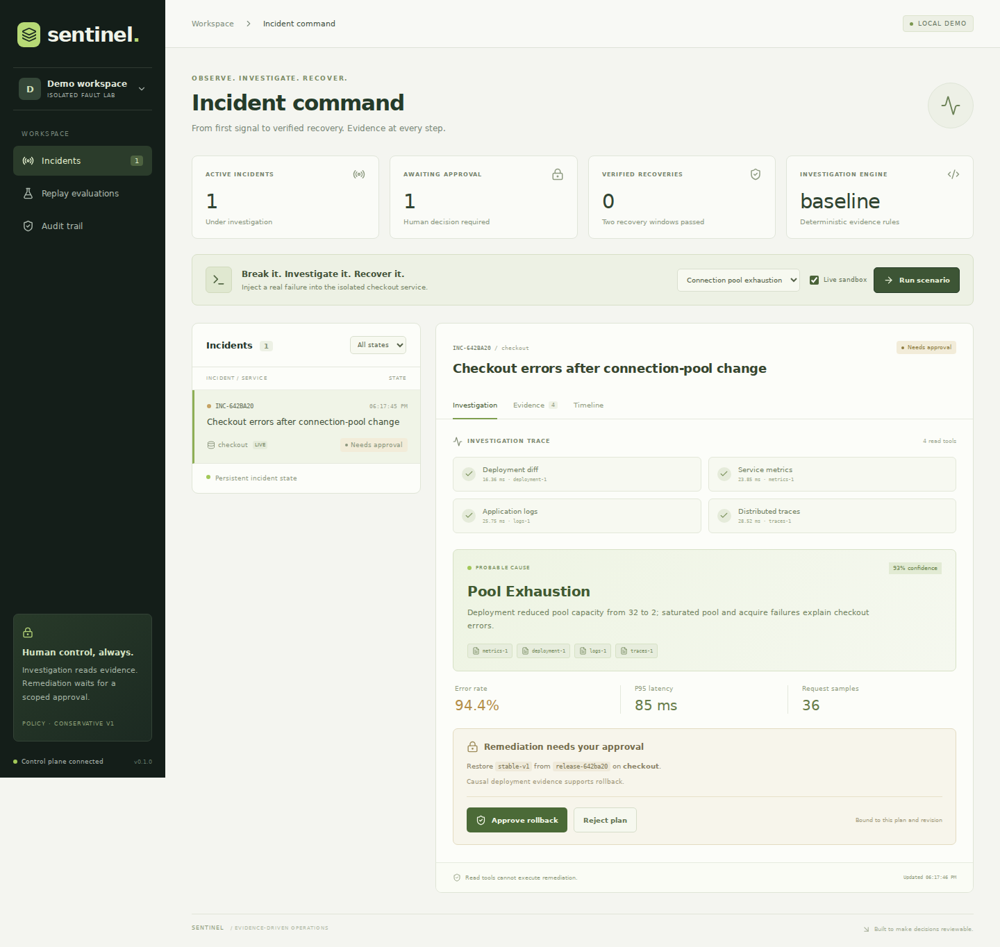
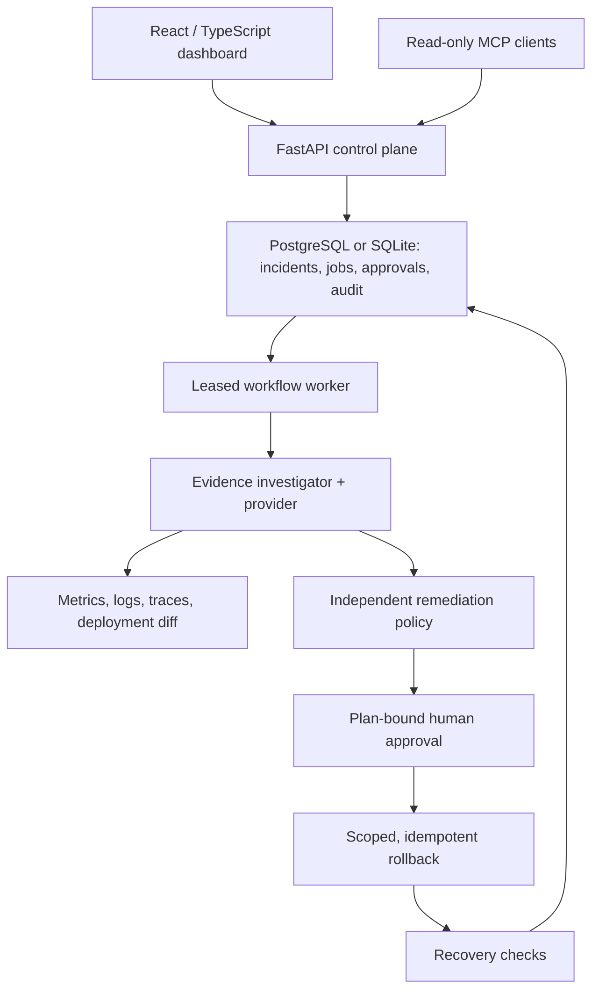

# Sentinel

**Evidence-driven incident investigation with human-approved remediation.**

Sentinel correlates a deployment with service metrics, logs, and traces, proposes a scoped rollback, waits for a human decision, and checks recovery. It includes a live HTTP fault lab, durable workflows, a React dashboard, a read-only MCP endpoint, replay evaluations, and an optional Kubernetes adapter.

This is a working engineering prototype. It is not a claim of production deployment, customer adoption, or autonomous SRE reliability.



## Try it locally

Requirements: Python 3.12+, Node 22+, npm. No API keys required.

```bash
python -m venv .venv
source .venv/bin/activate
pip install -r requirements-lock.txt
pip install -e . --no-deps
npm ci --prefix frontend
python scripts/dev.py
```

Open **http://127.0.0.1:5173**. The launcher explicitly enables local demo mode and binds all services to loopback. API documentation is at http://127.0.0.1:8000/docs.

1. Select **Connection pool exhaustion**.
2. Check **Live sandbox**, then **Run scenario**.
3. Inspect the deployment diff, request errors, and trace IDs.
4. Read the proposed diagnosis and approve the exact rollback plan.
5. Watch verification complete, then download the postmortem.

The dependency timeout scenario deliberately escalates: rolling back checkout is not supported by that evidence. A healthy scenario proposes no remediation. Synthetic replay also includes incomplete telemetry and adversarial log instructions.

### Docker alternative

```bash
docker compose up --build --wait
```

Open **http://127.0.0.1:8080**. Compose uses PostgreSQL for control-plane state and a separate persistent checkout sandbox. Compose is loopback-only and enables anonymous demo mode. Never expose this configuration publicly.

## What is implemented

| Capability | Implementation |
| --- | --- |
| Investigation | Four typed, allowlisted read tools; recorded timings and evidence citations |
| Providers | Deterministic baseline plus optional OpenAI and Anthropic JSON adapters |
| Policy | Independent evidence checks; unsupported, low-confidence, or unrelated rollback proposals cannot execute |
| Approval | Server-assigned operator role; approval bound to a SHA-256 plan digest and revision |
| Durable workflows | Database-backed queue, leases, heartbeats, retries, persisted state transitions |
| Remediation | Persistent idempotency and revision preconditions in the live sandbox; scoped Kubernetes JSON Patch adapter |
| Recovery | Request count, error rate, latency, memory trend, and target revision checks; failed recovery escalates |
| Audit | Tenant-scoped SHA-256 event chain, checked against a stored head |
| UI | Incident command, evidence inspector, event timeline, replay suite, audit verification, postmortem download |
| MCP | Stateless JSON-RPC initialize, ping, tools/list, and read-only tools/call |
| Telemetry | Real HTTP failures and OpenTelemetry SDK trace IDs in the checkout fault lab; instrumented FastAPI API |
| Storage | SQLite for easy local use; SQLAlchemy and PostgreSQL configuration for Compose / CI |
| Tests | Security, workflow, restart, idempotency, sandbox HTTP behavior, provider API mocks, Kubernetes API mocks |

## Architecture



Read [architecture decisions](docs/architecture.md), [security model](docs/security.md), [Kubernetes integration](docs/kubernetes.md), and the [two-minute demo script](docs/demo.md).

## Evaluate and verify

```bash
python -m pytest -q
python -m ruff check backend scripts
npm run build --prefix frontend
# Optional browser check after: cd frontend && npx playwright install chromium
npm run test:e2e --prefix frontend
python scripts/smoke.py
python -m sentinel.evaluate --output evals/local.json
```

`smoke.py` starts real API and sandbox servers on free loopback ports, creates three HTTP incidents, requires approval before rollback, and asserts healthy recovery or appropriate escalation. It cleans up its temporary databases and child processes.

The checked-in [baseline report](evals/baseline.json) contains **100 synthetic cases**: five failure classes, 20 variations each, and 50 cases with hostile log instructions. The deterministic baseline scored 100% diagnosis and plan accuracy with zero unsafe policy proposals. This is a regression check for the implemented taxonomy, not evidence of general LLM incident-solving ability. Four read tools are always called; this version does not optimize an adaptive tool search. Model cost is not invented: token usage is stored, and billing must be computed using the selected provider's actual prices.

CI runs Python checks, HTTP smoke tests, a PostgreSQL workflow test, frontend compilation, a Playwright browser workflow, and Docker Compose startup. Kubernetes tests and model provider tests use API mocks. Real Kubernetes rollout and paid model behavior require separate validation.

## Use a model provider

The baseline is intentionally explicit: it is deterministic evidence logic, not an LLM masquerading as one. For a real provider:

```bash
export MODEL_PROVIDER=openai
export MODEL_NAME='<a model your account can access that supports JSON output>'
export OPENAI_API_KEY='<your key>'
python scripts/dev.py
```

Or set `MODEL_PROVIDER=anthropic`, `MODEL_NAME`, and `ANTHROPIC_API_KEY`. A model is never selected silently. Provider failures retry the durable investigation job and eventually escalate. There is no fabricated fallback diagnosis.

To benchmark the actual provider, explicitly opt into API calls:

```bash
python -m sentinel.evaluate --provider openai --model '<model>' \
  --per-scenario 5 --output evals/openai-local.json
```

The conservative execution policy remains active for all providers. Paid provider paths are API-contract tested with mocks, not benchmarked in the checked-in report.

## Authenticated mode

Outside the launcher, startup defaults to authenticated mode and refuses to start without tokens. Configure server-side records:

```bash
export DEMO_MODE=false
export AUTH_TOKENS='{"replace-with-a-long-random-secret":{"tenant":"acme","actor":"lev","role":"operator"}}'
python -m uvicorn sentinel.api:application --factory --host 127.0.0.1 --port 8000
```

Roles are `viewer` and `operator`. The browser keeps a token in memory, never local storage. Tenant and actor are derived from the configured token, never caller-supplied role headers. Tokens are static prototype credentials; production would use OIDC, secret rotation, rate limits, and separate execution identities.

### MCP

POST JSON-RPC to `/mcp` with a configured bearer token, or use local demo mode. Example:

```json
{"jsonrpc":"2.0","id":1,"method":"tools/call","params":{"name":"query_metrics","arguments":{"incident_id":"<incident-id>"}}}
```

Only `get_deployment_diff`, `query_metrics`, `query_logs`, and `query_traces` are exposed. They read captured incident evidence, not arbitrary infrastructure. Rollback is not an MCP tool. This is a minimal stateless subset, not a complete implementation of every MCP transport capability.

### Configured external alerts

`POST /api/alerts` accepts an authenticated `{ "title": "Checkout failures", "source_key": "alert-123" }` for the tenant configured by `KUBE_TENANT`. It queues investigation of the configured Kubernetes deployment and telemetry gateway. It does not inject faults. The client cannot choose a cluster URL, namespace, template, or credential. See [the adapter contract](docs/kubernetes.md).

Vendor-native Sentry, PagerDuty, GitHub, Datadog, and CloudWatch connectors are future work. The current adapter boundary is usable without claiming those integrations already exist.

## Repository layout

| Path | Purpose |
| --- | --- |
| `backend/sentinel/agent.py` | Evidence collection, provider adapters, independent plan policy |
| `backend/sentinel/service.py` | Incident state machine, decisions, execution, verification |
| `backend/sentinel/store.py` | Transactions, leased queue, hash-chain audit |
| `backend/sentinel/api.py` | REST, SSE, authentication, MCP |
| `backend/sentinel/sandbox.py` | Live checkout HTTP fault lab |
| `backend/sentinel/kubernetes.py` | Pinned-template Kubernetes rollback adapter |
| `frontend/` | React dashboard with Vite, TypeScript, and responsive styling |
| `evals/` | Reproducible synthetic benchmark output |
| `docs/` | Decisions, limitations, demo narrative, and source references |

## Deliberate limits

The original vision includes Temporal, Kafka/Redis, native vendor integrations, enterprise onboarding, and real customer deployments. This version uses a transactional database queue instead: it is runnable and the crash/retry semantics are exercised. It has no shell-execution tool, arbitrary deployment command, or automatic remediation permission. Review [the roadmap](docs/roadmap.md) for the next steps required before a production rollout.

## License

MIT. Built by Lev Rachinskiy.
