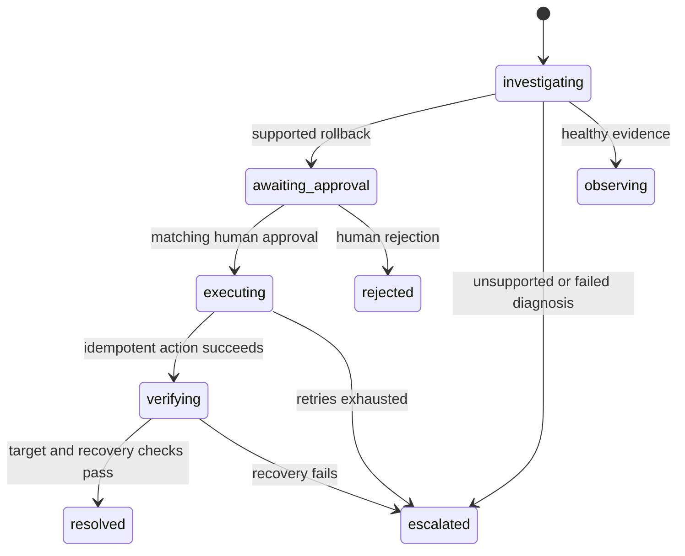

# Architecture decisions

## 1. Start with an executable vertical slice

The live lab is a separate HTTP service. A low-capacity checkout pool causes real HTTP 500s under concurrent requests; a retained-buffer simulation causes memory-budget errors; a payment delay causes 503s. Metrics and trace IDs come from these requests. Memory is a deterministic logical budget, not actual process RSS or a genuine OOM kill. The pool is an application-level concurrency limit, not a real PostgreSQL connection pool.

The agent's result is a proposed explanation of captured observations. The UI preserves evidence and citations so a reviewer can judge the diagnosis rather than trust an opaque summary.

## 2. Keep authorization outside the model

The investigator receives read-only data. Model output is parsed into a bounded schema. Unknown evidence IDs are rejected. A separate policy requires a supported deployment regression, sufficient request samples, high confidence, and a pinned rollback target. Human approval is a transaction tied to the full plan digest. A later executor rechecks the approval and deployment precondition.

The conservative policy recognizes the small implemented failure taxonomy. It trades breadth for inspectability. General-purpose model diagnosis would require broader, independent policy rules and held-out evaluations.

## 3. Database queue instead of Temporal and Kafka

Incidents, jobs, decisions, and audit records share a transactional database. This avoids a dual-write between incident creation and job publication. Jobs have queued/running/done/failed states, an owner token, a 120-second lease, a heartbeat every 20 seconds, and exponential retry delays. After three attempts a failure escalates.

Delivery is at least once. The external connector's idempotency key is stable across attempts. The live sandbox stores the action result and state update in one SQLite transaction. Kubernetes combines a version precondition with a persistent operation annotation. If a write succeeds but the worker crashes before committing, the retry recognizes the completed action.

API and worker currently share a process. A separate worker deployment, fairness controls, schema migrations, queue health metrics, and leases backed by database time are next steps. Startup uses `create_all`, appropriate for the prototype, not a migration strategy.

## 4. Finite state machine

Duplicate decisions with the same plan and decision return the existing state. Conflicting decisions return HTTP 409. A stale plan digest rolls back the decision transaction, so it cannot leave an incident in an execution state.

## 5. SQLite locally, PostgreSQL in Compose

SQLite WAL gives a simple, persistent local workflow with serialized writes. The PostgreSQL schema uses the same SQLAlchemy models. A per-tenant audit-head UPDATE serializes hash-chain appends; conditional job UPDATEs prevent two workers from claiming the same live lease. CI includes a PostgreSQL restart-and-recovery test, while the local test run uses SQLite.

There is no claim of horizontal scaling, benchmarked throughput, or a production high-availability deployment.

## 6. Captured evidence versus live observations

Investigation evidence is saved and remains reviewable. Recovery samples are separate from initial incident metrics. The live sandbox generates 36 concurrent requests for each sample and checks two samples. Fixtures are synthetic snapshots. The Kubernetes adapter waits up to 45 seconds for rollout convergence and reads two gateway samples one second apart. It requires the pinned template and healthy observed rollout. Gateway retention and fresh sampling are the integrator's responsibility; the current contract does not cryptographically prove freshness.

The UI uses SSE in anonymous local demo mode and polling for authenticated tokens. It does not put credentials in URL query strings. Polling also provides a recovery path if SSE disconnects.

## 7. React / Vite rather than Next.js

The dashboard is a client for an explicit control-plane API, so React and Vite provide a smaller build and no second application server. Python owns the domain logic. Nginx serves the compiled dashboard and proxies API/SSE in Compose. This decision changes packaging, not incident semantics.

## 8. OpenTelemetry scope

The API is instrumented with FastAPIInstrumentor. The checkout lab creates actual SDK spans and exposes their trace IDs alongside normalized logs and spans. A collector/export backend is not bundled. To export spans, configure a standard OpenTelemetry SDK exporter; normalized telemetry is a demo adapter, not an OTLP ingestion server.
